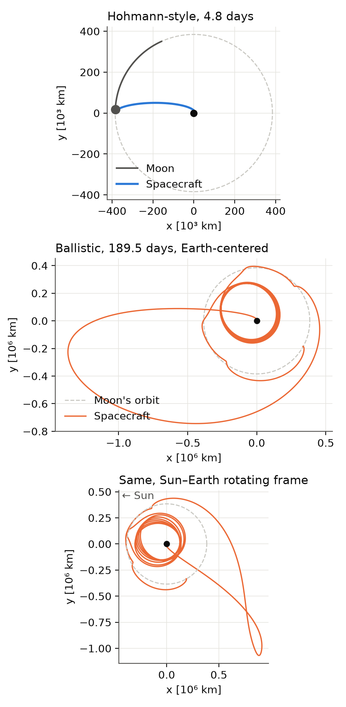

# A cheaper way to get to the Moon

We simulate two ways to get a spacecraft from low Earth orbit (200 km up) into a low orbit around the Moon (100 km up), and compare how much fuel each one needs. We measure fuel as **Δv**, the total change in velocity the engine has to supply.

- **Hohmann-style transfer:** the textbook route. One burn sends the spacecraft out to the Moon's distance, and a second burn at the Moon slows it down enough to stay there.
- **Ballistic transfer:** we go out of the way such that we gently drift into orbit around the Moon.

The simulation includes the gravity of the Earth, Moon, and Sun, and uses `scipy.integrate.solve_ivp` to step the spacecraft forward in time.


## Results



|                  | total Δv   | travel time |
|------------------|------------|-------------|
| Hohmann-style    | 3.943 km/s | 4.8 days    |
| Ballistic        | 3.827 km/s | 189 days    |

The ballistic route saves about 115 m/s, roughly 3% of the total. The catch is that the trip takes 40 times longer! (A ballistic trip of 102 days costs only 2 m/s more.)

## The code

| file | what it does |
|------|--------------|
| `physics.py` | constants, gravity, and small formulas (circular speed, energy, capture Δv) |
| `simulate.py` | flies one spacecraft forward in time and records what happens |
| `hohmann.py` | finds the Hohmann-style transfer |
| `search.py` | searches thousands of departures for ballistic captures |
| `plotting.py` | draws the figures |
| `run_hohmann.py`, `run_scan.py`, `make_plots.py` | the scripts you actually run |

## Running it

```
python3 -m venv .venv
.venv/bin/pip install -r requirements.txt
.venv/bin/python -m pytest -q       # quick checks of the physics
.venv/bin/python run_hohmann.py     # seconds
.venv/bin/python run_scan.py        # ~10 minutes: tries ~29,000 departures
.venv/bin/python run_scan.py --dv 3.1945 3.1960 121 --phase 330 360 0.1 --out results/runs_zoom.csv
.venv/bin/python make_plots.py      # picks the best runs and draws the figures
```
