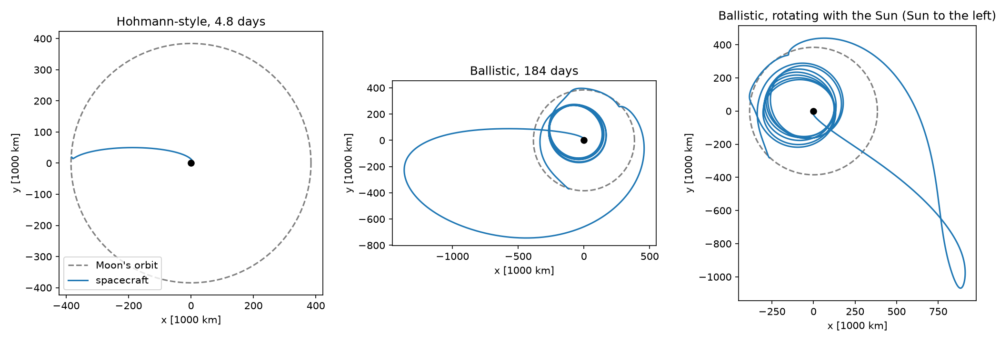
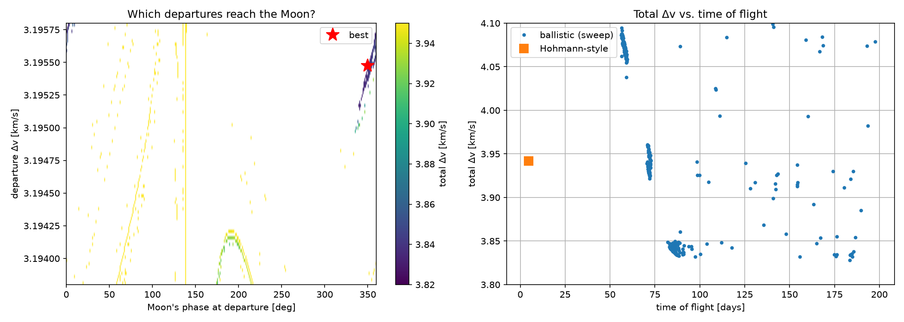

# A cheaper way to get to the Moon

We compare two ways to get a spacecraft from a circular orbit 200 km above the Earth into a circular orbit 100 km above the Moon. We measure the cost as **Δv**, the total change in velocity the engine has to supply (more Δv = more fuel).

- **Hohmann-style:** the textbook route. One burn throws us out to the Moon's distance, and a second burn at the Moon slows us down enough to stay there.
- **Ballistic:** we throw ourselves *way* out, about a million km, and let the Sun's pull bend the orbit so that we drift back in and meet the Moon slowly. Arriving slowly means a smaller second burn.

The spacecraft feels the gravity of the Earth, Moon, and Sun, and we step it forward in time with a Runge-Kutta (RK4) integrator we write ourselves.

## Results



|                  | total Δv   | travel time |
|------------------|------------|-------------|
| Hohmann-style    | 3.942 km/s | 4.8 days    |
| Ballistic        | 3.828 km/s | 184 days    |

The ballistic route saves about 114 m/s, roughly 3% of the total. The catch is that the trip takes almost 40 times longer! Look at the cluster of points around 85–100 days in the plot below, though: for about 4–5 m/s more, we can get there in roughly half the time.



## How it works

`moon.py` has all the physics.

- `moon_position`, `sun_position`: both move on circles.
- `pull`: the acceleration from one body. Our frame sits on the Earth, so we subtract that body's pull on the Earth too.
- `derivative`: d(state)/dt for state = [x, y, vx, vy].
- `rk4_step`: one Runge-Kutta step.
- `fly`: burn, then coast with RK4, and record the closest approach to the Moon.
- `capture_dv`: the burn at 100 km above the Moon, using conservation of energy.

`hohmann.py` finds the Hohmann-style transfer with the **shooting method**.

`ballistic.py` finds the ballistic transfer by **brute force**. There are two knobs here (departure Δv and the Moon's starting angle), but no single target to aim at. We want *any* trajectory that arrives slowly, and among those, the cheapest. We fly ~29,000 combinations, score each one, and keep the best.

A few simplifications are worth knowing about:

- We assume we burn at the closest approach to the Moon, and estimate that burn as if the closest approach were exactly 100 km up.
- We fix the Sun's starting angle at 25°, and only search a narrow window of departure Δv. That window is where the Sun happens to bring us back to the Moon's distance.
- The step size is 1% of the local orbital time scale.

## Running it

```
python3 -m venv .venv
.venv/bin/pip install -r requirements.txt
.venv/bin/python -m pytest          # checks we can do by hand
.venv/bin/python hohmann.py         # a few seconds
.venv/bin/python ballistic.py       # about 2 minutes; writes figures/
```
